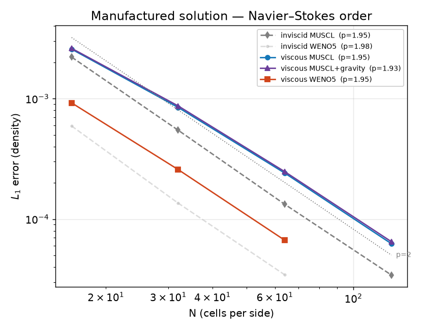

# Manufactured solution (MMS) — *verification (Navier–Stokes order)*

**Objective.** Verify the **Navier–Stokes** operator (and its source
coupling) converges at its design order 2. A smooth stationary solution is
made an exact solution of the forced equations by the source term
$S = \nabla\!\cdot F_{\rm Euler} - \nabla\!\cdot F_{\rm visc}$; the
discrete L1 error at a fixed time must then fall as $O(h^2)$ **and must not
depend on the time step**. This is the only gate that pins the **viscous**
operator's order and the source/predictor coupling (the
[order-of-accuracy](order_of_accuracy.md) fiche covers the inviscid transient
order).

## Numerical setup
> Smooth periodic manufactured solution (sinusoidal ρ,u,v,p), source computed
> **in double** by 4th-order finite differences and passed to the scheme (it
> enters the Hancock predictor / every RK stage). Start from the exact field,
> advance to T = 0.5, measure L1(ρ) vs the manufactured field, N = 16 → 128
> (WENO5 → 64: above that its per-step increment falls under the float32 ulp
> and the state stagnates), μ = 0.01, CFL 0.4. Observed order = finest pair
> (N = 16 is pre-asymptotic). Schemes MUSCL & WENO5 (+ a gravity variant),
> plus a CFL-sensitivity check e(0.4)/e(0.2) at N = 64. Driver: `mms`. float32.

## Results

| Operator | Observed order |
|---|---|
| viscous, MUSCL | 1.95 |
| viscous, WENO5 | 1.95 |
| viscous + gravity, MUSCL | 1.93 |
| inviscid, MUSCL | 1.95 |
| CFL sensitivity, inviscid MUSCL (gate 5 %) | +0.3 % |
| CFL sensitivity, viscous MUSCL (info) | +14.4 % |

## Discussion
Both schemes reach order **~2** on the viscous operator, capped at 2 by the
**central 2nd-order viscous flux** shared by MUSCL and WENO5, and the
gravity variant stays at 2. Inviscid MUSCL is order 2 with an error
independent of the CFL. This used to be ~1: the source was added *after*
the step, outside the Hancock predictor, which leaves an O(dt) error on the
equilibrium (error ∝ CFL). The same splitting affected gravity; both now
enter the predictor as a half-dt term (CPU and GPU), which also makes a
fluid at rest under gravity hydrostatically balanced to the float32 floor.
The viscous flux is still evaluated outside the predictor, hence the
remaining CFL sensitivity of the viscous case (informative until it moves
into the predictor).

---
*Part of the [V&V dossier](../README.md). Regenerate: `python3 vv/generate.py`. Source data: [`../data/`](../data/).*
